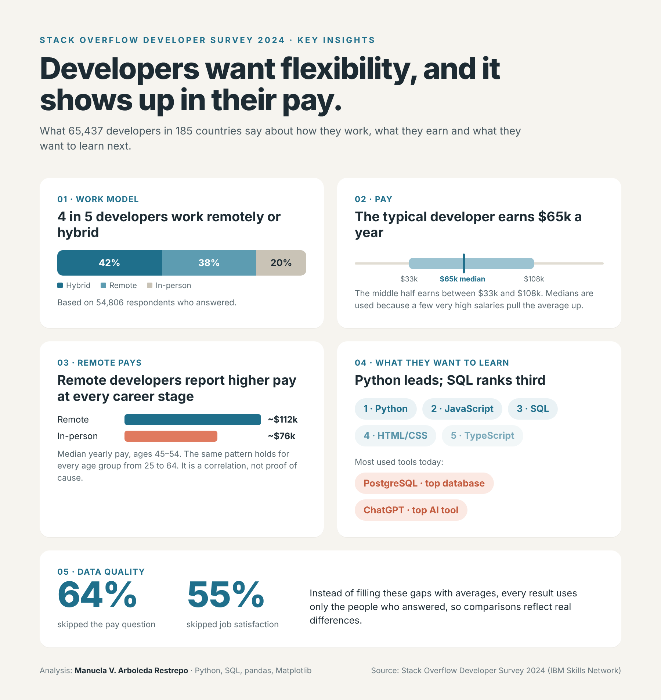

# What Shapes Developer Pay and Work in 2024?

**An end-to-end analysis of the Stack Overflow Developer Survey: 65,437 respondents across 185 countries.**

I collected, cleaned, analyzed and visualized survey data to answer one business question:

> *If you were hiring, training or marketing to developers, what should you know about where they work, how they are paid and which tools they want to learn next?*



---

## Key findings

| # | Finding | Why it matters |
|---|---|---|
| 1 | **80% of developers work remotely or hybrid** (42% hybrid, 38% fully remote); only 20% are fully in-person. | In-person-only roles compete for a small share of candidates. |
| 2 | **Median yearly pay is $65,000** ($69,814 for full-time employees); the middle half earns about $33k–$108k. | Averages mislead here: a small group of very high earners pulls the mean up, so medians are used throughout. |
| 3 | **Remote developers report higher median pay than in-person peers in every age group from 25 to 64** (e.g. about $112k vs. $76k at ages 45–54). | Flexibility and pay go together, though this is a correlation: country mix is checked in the notebook. |
| 4 | **Python, JavaScript and SQL** are the languages developers most want to work with. | SQL's place in the top 3 shows that data skills are core, not niche. |
| 5 | **PostgreSQL** is the most used database, and **ChatGPT** is the most used AI tool. | Useful for prioritizing training content, partnerships or ad targeting. |
| 6 | **64% of respondents skipped the pay question** and 55% skipped job satisfaction. | Every result is reported with its real sample size instead of filling gaps with guesses. |

## Approach

1. **Collect:** pulled data from a REST API, scraped web pages and loaded the survey (CSV and SQLite with SQL queries).
2. **Clean:** removed duplicates, audited missing values, converted text fields (age ranges, years of experience) into numbers and treated pay outliers.
3. **Analyze:** profiled respondents, compared groups with medians and cross-tabulations, and measured correlations.
4. **Communicate:** built charts with clear insight titles, an interactive dashboard and a one-page summary for non-technical readers.

### A decision I revisited
In the course version I filled missing pay and satisfaction values with the median. Because most respondents skipped those questions, that made thousands of people look identical and hid real differences. In the final analysis I **only use people who answered each question** and report the sample size, which gives more honest results.

## Tools
Python (pandas, NumPy, Matplotlib, Seaborn) · SQL (SQLite) · REST APIs · web scraping (BeautifulSoup) · IBM Cognos Analytics · Jupyter

## Repository structure
```
├── analysis/
│   └── developer_survey_analysis.ipynb   ← start here: the full analysis and findings
├── dashboard/
│   └── dashboard_data_prep.ipynb         ← prepares the data for the Cognos dashboard
├── images/                               ← charts and the one-page summary
├── labs/                                 ← step-by-step course work (collection, wrangling, EDA, visualization)
└── requirements.txt
```

## How to run
```bash
pip install -r requirements.txt
jupyter notebook analysis/developer_survey_analysis.ipynb
```
The notebook downloads the dataset automatically. It also runs in Google Colab.

## Data source
Stack Overflow Annual Developer Survey 2024, as provided by IBM Skills Network for the IBM Data Analyst Professional Certificate (Coursera).

---

**Manuela V. Arboleda Restrepo** · Marketing professional and data analyst. I turn data into decisions for marketing, research and business teams.
[LinkedIn](https://linkedin.com/in/manuela-arboleda) · mvarboledar@gmail.com
